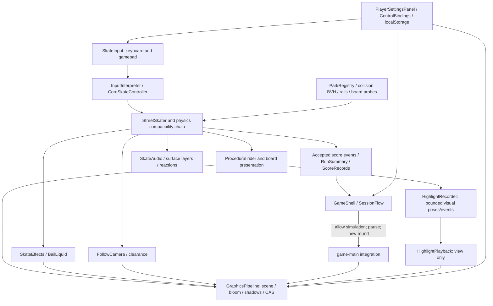

# System architecture

Current architecture observed on 2026-11-03. This is a map of the existing game, not a proposed rewrite. [Profile](PROJECT_PROFILE.md) · [State](PROJECT_STATE.md).

## Authority boundaries

- Simulation owns position, travel/stance, collision acceptance and trick scoring. Camera, shaders, lettering and IK must not rewrite physical root movement.
- `CoreSkateController` and pure result modules are the canonical decision seams. Existing class names provide migration compatibility; adding more override layers would increase risk. See the detailed [authority map](phase1-core-authority-map.md).
- `SessionFlow` owns ready/play/overtime/finish policy. Full `reset()` starts a new round; `resetRider()` respawns inside the same round, preserving accepted score/distance/stance and incrementing the contact serial. Practice-marker returns use the same transaction, then restore the marker's saved stance.
- `RunSummary` observes accepted settlements. Pose replay cannot award scores, advance physics or fabricate a live landing. Respawn serials separate contact segments.
- `ParkRegistry` validates spawn, collision, rails and boundaries before a world commit. It disposes replaced resources while retaining shared textures. Actor loads are cancellable/generation checked.
- `GraphicsPipeline` owns render state restoration and bloom masking. Static scenery local transforms are frozen; actors/bones remain dynamic. Rider identity invalidates actor masks immediately, without adding a per-frame whole-scene walk.
- `game-main` bridges runtime, menu and toolbar sound through one setter. `SkateAudio` remains the actual persisted enabled-state authority.
- Tutorial tables and video cues consume current validated bindings. Fixed menu navigation remains separate from remappable skating actions.

## Remaining structural debt

`game-main.js` and `GameShell.js` still combine many responsibilities; the physics migration retains a long compatibility chain. Extract one tested responsibility at a time when a feature requires it. Avoid a broad framework/engine conversion or gameplay rewrite for presentation fixes. [Decisions](DECISIONS.md) · [Known issues](KNOWN_ISSUES.md).
